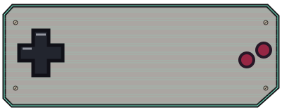

<p align="center">
  
</p>

<h1 align="center">Alify</h1>

<p align="center">Tu colección de música en un reproductor gratuito para Windows.</p>

<p align="center">
  <a href="https://github.com/VerVo-Lab/Alify/blob/main/downloads/Alify-Setup.exe?raw=true"><strong>⬇️ Descargar para Windows x64 · 7,3 MB</strong></a>
  <br>
  <a href="https://github.com/VerVo-Lab/Alify/blob/main/downloads/Alify-Setup-x86.exe?raw=true"><strong>⬇️ Descargar para Windows de 32 bits (x86) · 7,1 MB</strong></a>
</p>

## 🖥️ Instala Alify

1. Abre el instalador que descargaste y sigue el asistente.
2. Deja marcada la opción **Crear acceso directo en el escritorio** y pulsa **Finalizar**.
3. Abre **Alify** desde el escritorio o el menú Inicio.

> Si falta Microsoft Edge WebView2, el instalador lo descarga. Si GitHub te pide iniciar sesión para descargar Alify, usa una cuenta con acceso al repositorio.

## 🎵 Añade tu música

Ve a **Configuración → Elegir carpeta de música** y selecciona la carpeta que contiene tus canciones. Alify leerá los títulos, artistas y portadas que estén guardados en los archivos.

- 🔀 **Reproducción.** Organiza tus listas, consulta la cola y activa el orden aleatorio. Usa **Espacio** para pausar o reanudar.
- 🎤 **Letras sincronizadas.** Abre **Letras** desde el reproductor. Alify sigue las marcas LRC y busca una posible entrada de voz para ajustar el comienzo.
- 🎛️ **Minirreproductor.** Abre la ventana flotante desde la barra, ajusta su tamaño o acóplala arriba. Pulsa **Expandir** para recuperar su tamaño y posición.
- 📊 **Wrapped.** Consulta tu tiempo de escucha y tus canciones más reproducidas. Puedes descargar el resumen como PNG con el fondo del tema activo.

La música local se reproduce sin conexión. Las búsquedas en servicios externos requieren Internet. Tu biblioteca y tus preferencias se guardan en tu perfil de Windows.

## 🎨 Elige un diseño

Aplica un tema en **Temas y diseños**. Cada uno cambia la apariencia de la aplicación y de su minirreproductor.

| Frutiger Aero | Metalcore Gótico | Retro Videojuego |
| :---: | :---: | :---: |
|  |  |  |
|  |  |  |

## 🧰 Desarrollo y publicación

<details>
<summary>Compilar el instalador desde el código</summary>

En Windows x64 instala Node.js 20 o posterior con npm, Rust con MSVC, Visual Studio Build Tools con **Desarrollo para el escritorio con C++** y WebView2. Desde la raíz del repositorio ejecuta:

```powershell
npm ci
npm run tauri build
```

- **Ejecutable** — `src-tauri/target/release/alify.exe`
- **Instalador NSIS** — `src-tauri/target/release/bundle/nsis/*-setup.exe`
- **Modo desarrollo** — `npm run tauri dev`

Al subir una etiqueta `v*`, el [flujo de publicación](.github/workflows/release-windows.yml) compila y adjunta el instalador, la versión portátil y sus sumas SHA-256. Para actualizar la descarga directa del README, reemplaza también `downloads/Alify-Setup.exe`.

</details>

Para desinstalar, busca **Alify** en **Configuración → Aplicaciones → Aplicaciones instaladas** de Windows.
